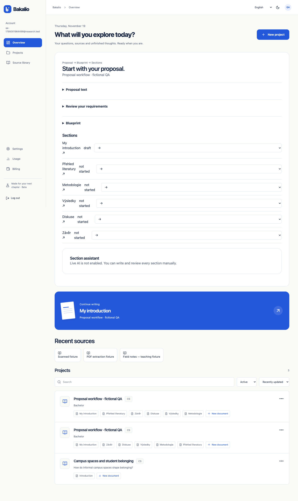

<p align="center"></p>

# A thesis studio, built one section at a time

Bakalio brings assignments, chapter plans, manuscripts and sources into one student-focused workspace. Built with Open SaaS / Wasp, React, PostgreSQL and Tiptap. **Active development; not a finished commercial service.**

[Try the interactive demo](https://bakalio.eurun.eu.org/demo) · [Implementation status](IMPLEMENTATION_STATUS.md) · [Architecture](ARCHITECTURE.md) · [Report an issue](https://github.com/yuanweize/Bakalio/issues)

[Čeština](README.cs.md) · [简体中文](README.zh-CN.md)



## What works

- Private projects, rich-text documents, autosave, optimistic concurrency, revision recovery and private PDF/text sources.
- Assignment input → explicitly located requirements → user confirmation → versioned generic blueprint → persistent chapter documents.
- Independent interface and manuscript languages; English, Czech and Simplified Chinese UI.
- DOI metadata checks against Crossref, with explicit L0/L1 scope and stale checks after source edits.
- Editable generic DOCX export with headings, contents field, citations, bibliography and page numbers; Markdown/text exports in the editor.
- OpenAI-compatible server adapter and persistent PgBoss tasks, explicit opt-in, token reservations, cancellation and acceptance before replacing a draft. **Production AI remains disabled.**

The public demo uses fictional teaching data and simulated AI. Proposal extraction currently uses explicit field labels; generic blueprints are not AI-generated. Original-results generation is blocked. Full semantic claim verification, anchored comments, school-certified templates, OCR and payments are unfinished. See [the exact release boundaries](IMPLEMENTATION_STATUS.md).

## Quick start

Requirements: Node **24.22.1+** (supported range <27), npm, Docker Compose, curl and tar. No paid service is needed for basic writing or the demo.

```sh
git clone https://github.com/yuanweize/Bakalio.git
cd Bakalio
./scripts/setup.sh
./scripts/wasp start --client-port 4310 --server-port 4311
```

Setup downloads the checksum-verified Wasp 0.26.1 binary, installs dependencies, generates local secrets, starts PostgreSQL/Mailpit and applies migrations. Open `http://localhost:4310`. Development verification emails are captured at `http://localhost:8126`; this is not outbound email delivery. Never expose Mailpit or PostgreSQL publicly.

## Configuration

Use [.env.example](.env.example) for Compose and [app/.env.example](app/.env.example) for development. Keep actual files untracked. Registration is closed by default in production until outbound SMTP and operator details are ready. Adding an AI key does **not** enable calls: `AI_ENABLED`, endpoint/model and a positive token budget are independently required. See [AI execution](docs/THESIS_WORKFLOW.md).

## Self-hosting

```sh
PUBLIC_API_URL=https://your-domain.example/api ./scripts/build.sh
docker compose -f compose.yaml -f compose.production.yaml build
docker compose -f compose.yaml -f compose.production.yaml up -d
```

Set `PUBLIC_WEB_URL`, `PUBLIC_API_URL`, database/JWT secrets and real SMTP in your private environment. Configure HTTPS in your reverse proxy. nginx proxies `/api/` to Wasp; the browser must never contain private API addresses. `compose.source.yaml` provides a source-build alternative; its clean-build validation is still pending.

The Compose project name remains `research-studio` to preserve existing named volumes. Do not use `down -v`. See [backup scripts](scripts/backup.sh) and [restore verification](scripts/check-backup.sh). The host must remain running and awake.

## Development and validation

```sh
cd app
npm run typecheck
npm test
npm run lint
```

Browser tests reuse installed Chrome. E2E scripts create isolated fictional test accounts and write credentials only under ignored `.data/`. Run account setup tests before tests that use those fixtures. Detailed results and missing acceptance tests are in [IMPLEMENTATION_STATUS.md](IMPLEMENTATION_STATUS.md).

## Architecture and privacy

Wasp owns authentication, Prisma generation and PgBoss. PostgreSQL is the source of truth; uploaded documents use a private volume. Every operation checks ownership. AI task inputs are bounded; uploaded source content cannot grant tools or system permissions. Do not send unpublished research to any model without reviewing the provider and consenting to that transfer.

This is not plagiarism detection, a guarantee of factual correctness or a promise that a university will accept AI-assisted work. No fabricated reviews, institution partnerships or usage claims are used. GDPR operational procedures, account-erasure UI and legal/operator review remain release work.

## Roadmap and contribution

Next: proposal AI analysis, structured evidence/claim review, anchored comments and revision diffs, configurable templates, richer DOCX fidelity and verified async recovery. [Contribution guide](CONTRIBUTING.md) · [Security reporting](SECURITY.md).

## License and credits

MIT; the original Wasp/Open SaaS copyright is preserved. [Third-party notices](THIRD_PARTY_NOTICES.md). Code licensing does not imply endorsement or permission to present a modified product as the official Bakalio service.
